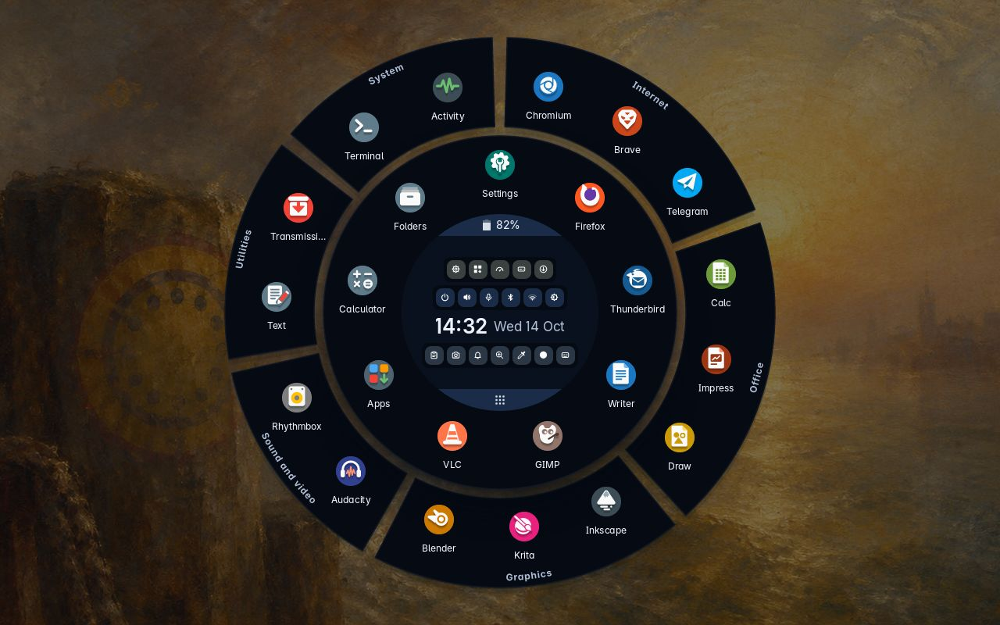
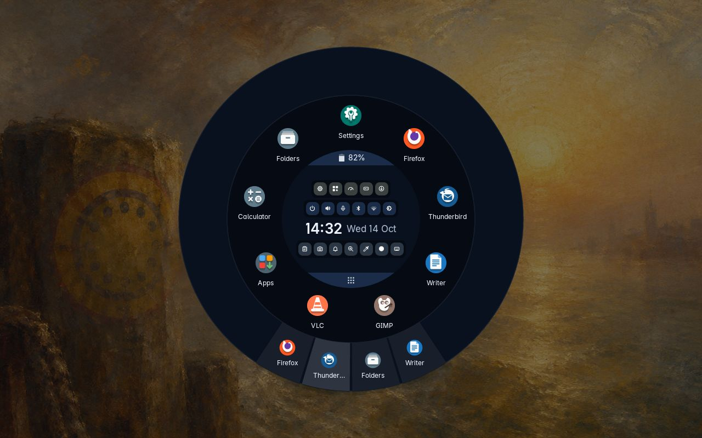
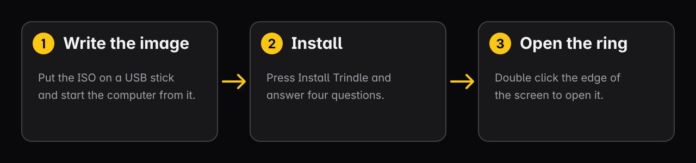
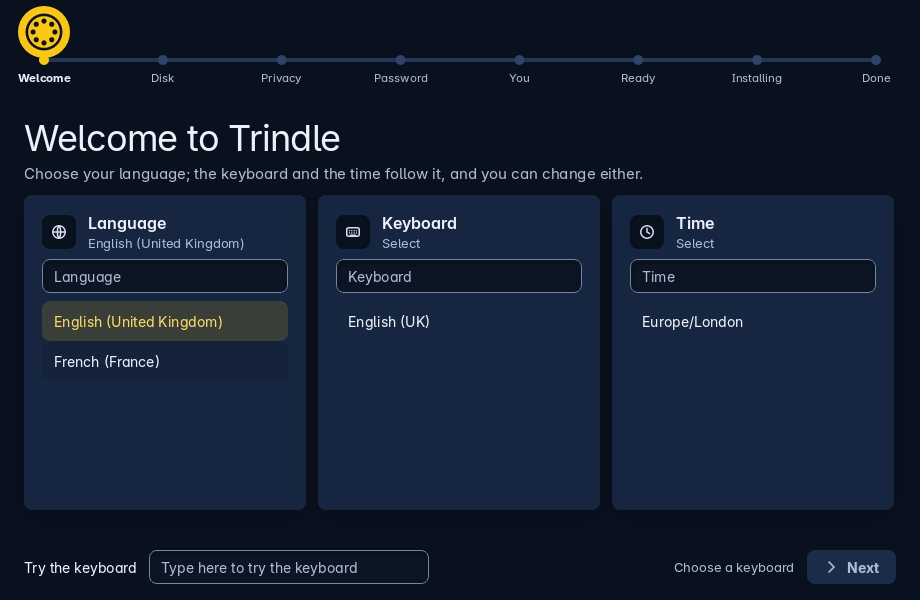

<div align="center">


[](CHANGELOG.md)
[](LICENSE)
[](https://trindle.org/install.html)
[](SECURITY.md)

[trindle.org](https://trindle.org) · [A look round](https://trindle.org/tour.html) · [Security](SECURITY.md) · [Contributing](CONTRIBUTING.md) · [Changelog](CHANGELOG.md)

## Before you install

**Most of what is described here is written and running; a few parts are still being built.** What it has not had is a year of other people's hardware,
other people's printers and other people's ideas about what a computer ought to
do. Please put it on a spare machine and tell us what breaks.

**Back up anything that matters first.** Installing changes how a machine
starts, logs in and handles disks, and it replaces or resizes what is on the
disk you choose.



</div>

Trindle is a desktop with just one ring. It is written in Rust, down to the compositor that puts
every window on the screen, with Debian 13 underneath. Nothing sits on the
screen while you work but your windows and the wallpaper: no bar, no dock, no
menu button. Double-click at the very edge of the screen, or press Super, and
the ring opens in the middle of the screen, your programs round it and the
clock in the middle. Start what you want and it opens as a normal window, like
anywhere else. Close the ring and the screen is yours again.

It is built for a cursor and a fingertip, and once the optional voice extra is
added in Settings you can open an app by saying its name, understood on the
machine itself with nothing sent anywhere.

Free, open source, and no account, no telemetry and no company behind a login.

<div align="center">

</div>

## How it works

<div align="center">

</div>

## What is in it

| | |
| --- | --- |
| **The ring** | Open windows, favourites, everything else under All apps, the clock, and round buttons for sound, Bluetooth, Wi-Fi, brightness and battery. Opens with a double click at the very edge of the screen or on the empty desktop, or with Super. |
| **Quick panels** | Press a button and a page opens in the middle of the ring: volume and microphone, Bluetooth pairing, Wi-Fi with a password box, brightness, battery and power modes. |
| **Tools in the ring** | Round buttons in the middle of the ring for Settings, Apps, Activity, Drives, Screenshot, the clipboard, notifications, the magnifier, the eye dropper and Report a problem, and the tray icons of other programs. At most four tray icons show; a button opens the rest. |
| **Apps** | Flathub apps, AppImages, Debian's own, software sources, and backups of app settings you can carry to another computer. |
| **Snapshots** | On Btrfs, the system is photographed before and after every software change. Put it back from Settings, or from the boot menu when it will not start. |
| **Clipboard** | What you copied, with a filter, pins, and forgetting after a time you choose. Never pastes into anything by itself. |
| **Voice** | Optional, added in Settings. Tap the middle of the ring and speak; it stops when you stop talking. It runs on the computer and nothing you say is sent anywhere. |
| **Light or dark** | Chosen in Settings, Appearance, with twenty colours for the highlight, or one you type; the whole desktop follows at once. |
| **Magnifier** | A round button in the ring turns on a circle of magnified screen that follows your finger or pointer, at 2.6 times life size. |
| **On-screen keyboard** | A round button in the ring, once it is switched on in Settings, for a touchscreen. |
| **Printers** | Settings finds printers on the network, looks for the driver each one wants, and adds it. |
| **Updates** | Your apps, Debian and Trindle itself on one page, each with one button, and a snapshot taken round every change. |

## Quick start

Trindle comes as an installation image, built from `tools/iso/`. Write it to a USB stick, start the computer from it and press **Install Trindle**. Nothing else is needed; the steps are below. Once installed, double-click at the very edge of the screen, or press Super, and the ring opens.

## Installing

**From the image.** Write the ISO to a USB stick with Impression, balenaEtcher
or `dd`, start the computer from it, look around first if you like, then press
**Install Trindle**. The Trindle Installer asks four things: your language, which the keyboard
and time follow; the disk, whole or shared with Windows or another Linux; a lock
for the disk if you want one, opened by a password or by the computer's own TPM
chip; and your name and password. Other systems on the disk are listed in the
boot menu afterwards.

<div align="center">

</div>

There is no other way in. There is no install script to clone and run, and no
package to add to a Debian you already have: the image is the only way to get
Trindle.

If the login screen ever fails, **Ctrl+Alt+F2** gives a text login: Trindle uses
only VT 7 and leaves the other consoles alone.

> Trindle is provided as is, with no warranty of any kind, and you use it at
> your own risk. It changes how the computer starts, logs in and handles disks,
> so back up anything that matters first. See sections 15 and 16 of `LICENSE`.
> It is tested on Debian stable only; on testing or unstable it has not been
> tried and nothing can be promised.

## Keys

| Keys | What happens |
| --- | --- |
| Super, or Super + Space | The ring opens or closes |
| Super + Enter, or Ctrl + Alt + T | Terminal |
| Super + I | Settings |
| Super + Q | Close the window |
| Super + Up / Super + Down | Fill the screen, or tuck the window away |
| Super + D | Show the desktop, and bring the windows back |
| Super + L | Lock the screen, once locking is switched on |
| Super + K | Every keyboard shortcut, in a list |
| Super + Alt + S | Will turn Trindle's own screen reader on or off; it is being built, and for now says so |
| Super + N | The keyboard into the notifications |
| Ctrl + Shift + Esc | Activity, to see and stop what is running |
| Alt + Tab | Each open window to the front in turn |
| Print, or Super + Shift + S | Screenshot: the screen freezes, you drag out a part or take it all and mark it, and Enter saves it into ~/Pictures/Screenshots and copies it |
| Shift + Print | Screenshot of the whole screen at once |

## How it is put together

One Rust program answers to almost every `trindle-*` name; `trindle --names`
lists them. Two are programs of their own, built from the same source:
`trindle-compose`, the compositor, which puts every window on the screen, from
the login screen on; and `trindle-unlock`, the
disk-password screen, which runs before the desktop is there. Only `trindle-admin`
runs as root, through pkexec, and it checks every argument and reads passwords
from standard input alone.

| Path | What is in it |
| --- | --- |
| `src/` | The program. Installed in `/usr/lib/trindle`. |
| `share/` | Stylesheet, icons, wallpapers, fonts, GRUB theme. |
| `config/` | The compositor's shortcuts and the session's environment (`config/desktop/`), the terminal's and GTK's settings, and the starting favourites. |
| `system/` | The system's own files Trindle installs: greetd, polkit, PAM, GRUB, initramfs, systemd, apt, dpkg, udev, sysctl, tmpfiles, the portal and kernel settings. |
| `tools/iso/` | The installation image builder. |
| `docs/` | The pictures this page shows. The website at trindle.org is its own repository, trindle-site. |

Your own settings live outside the repository, in `~/.config/trindle/`:
`trindle.conf`, `environment` (the keyboard layout chosen in Settings) and, if
you add one, your own `shortcuts.xml`.

## Building it

Trindle is built on Debian 13. Cargo fetches the Trindle Toolkit from its
repository at the commit `Cargo.toml` names (the repository is private until
the first release). The Toolkit is published first, with that commit on its
main branch; only then can a clean clone of Trindle build. `share/style.css`,
`share/themes`, `src/said.rs` and `src/compose/protocols/own_press.xml` are
copies of the Toolkit's own, and `cargo test` fails if one differs from the
Toolkit it was built with.

```bash
sudo apt install cargo rustc pkg-config libpam0g-dev libxkbcommon-dev libpixman-1-dev \
    libseat-dev libinput-dev libudev-dev libgbm-dev libdrm-dev libdisplay-info-dev
cargo build --release
cargo test --release
```

To work on the Toolkit and Trindle together, check the Toolkit out beside
this folder and put this in `.cargo/config.toml` (not committed). While it
stands, cargo writes the local copy into `Cargo.lock` in place of the commit,
so `tools/build.sh` does not hold that build to the lock; run `tools/lock.sh`
before committing the lock. A clean clone has no such file, and
`tools/build.sh` builds it with `--locked`:

```toml
[patch."https://github.com/trindle-os/trindle-toolkit"]
trindle-toolkit = { path = "../trindle-toolkit" }
```

Help is a program and a repository of its own, trindle-help. The tests that
tie Trindle's "More" messages to Help's pages take its small library from the
commit Cargo.toml names, so a clean clone needs nothing beside it. To work on
both together, patch it to the folder beside this one:

```toml
[patch."https://github.com/trindle-os/trindle-help"]
trindle-help = { path = "../trindle-help" }
```

The installation image (`tools/iso/build.sh`) needs the icon packages from the
trindle-icons project; the script says what is missing before it does anything.

Inside a Trindle session, any part can be run by name:

```bash
target/release/trindle ring
target/release/trindle apps
target/release/trindle settings --panel network
```

A new Settings page is one file in `src/settings/panels/` and one line in that
folder's `mod.rs`.

### The Debian packages Trindle installs

Installed with `--no-install-recommends`; nothing else is pulled in.

<!-- packages -->
| Package | For |
| --- | --- |
| `xwayland` | older X11 programs |
| `libseat1` | the screen, keyboard and mouse, handed over by logind |
| `libinput10` | keyboard, mouse, touchpad and touchscreen |
| `libgbm1` | buffers the graphics card draws into |
| `libdisplay-info2` | what each screen says it can do |
| `libegl1` | drawing with the graphics card, or the processor without one |
| `libegl-mesa0` | the graphics driver behind it |
| `libgles2` | what the compositor draws with |
| `libgl1-mesa-dri` | the drivers themselves, and llvmpipe for no graphics chip |
| `libpixman-1-0` | the compositor's cursor and fallback drawing |
| `libxkbcommon0` | keyboard layouts in the compositor |
| `trindle-folders` | the file manager, a package of its own |
| `trindle-help` | Help, a package of its own; one of the programs a person cannot uninstall |
| `trindle-toolkit-lang` | the Toolkit's words in every language, shared with Folders and Help |
| `trindle-voice` | speech for the screen reader and Talk; the models (253 MB) are added by the image build |
| `gvfs-backends` | network places and phones for other programs: Folders speaks its own, but GTK programs and Flatpak apps allowed to (Firefox, Text Editor) reach shares, phones and web addresses through it; kept |
| `wvkbd` | keyboard on screen, for touch |
| `xdg-terminal-exec` | how other programs start a terminal app: Trindle starts terminals itself, but GLib (a file opened by a Flatpak app, a GTK program) knows only a few terminals by name and asks this for any other; kept |
| `libvpx9` | moving wallpapers, played by Trindle itself |
| `flatpak` | Flathub apps |
| `zstd` | app settings backups |
| `unzip` | fonts added in Settings |
| `xdg-desktop-portal` | Flatpak file and link access |
| `hunspell-en-gb` | spelling in Text, British English |
| `libfuse2t64` | older AppImages |
| `fuse3` | newer AppImages |
| `greetd` | login manager |
| `curl` | release download |
| `systemd-coredump` | keeps the details of a crash, for a report the person chooses to send |
| `ca-certificates` | TLS for the download |
| `adwaita-icon-theme` | GTK fallback icons |
| `fonts-noto-core` | wide language coverage |
| `fonts-dejavu-core` | monospace |
| `fonts-noto-color-emoji` | colour emoji |
| `xdg-utils` | xdg-open |
| `xdg-user-dirs` | makes Documents, Downloads and the rest |
| `gvfs-fuse` | gives what those programs open on a network place an ordinary path, so a program that only takes paths can open it too; kept with gvfs-backends |
| `p11-kit` | certificate store used by Flatpak |
| `libglib2.0-bin` | gio, default apps |
| `dbus-user-session` | session bus |
| `gsettings-desktop-schemas` | GTK theme, font, dark mode keys |
| `dconf-gsettings-backend` | GSettings storage |
| `trindle-circle-icon-theme` | the round app icons, the default; from Trindle's own repository |
| `papirus-icon-theme` | what both build on, and the pictures inside the icons Trindle makes |
| `librsvg2-common` | SVG icons in GTK programs |
| `pipewire-audio` | sound |
| `libasound2-plugins` | lets a boxed program that opens ALSA reach the sound guard (pulse plugin) |
| `network-manager` | networking |
| `network-manager-config-connectivity-debian` | spots Wi-Fi that wants a sign-in first, through Debian's own check; always on |
| `wpasupplicant` | Wi-Fi: NetworkManager finds no network without it |
| `modemmanager` | mobile broadband, on laptops with a SIM: NetworkManager cannot use a modem without it; kept so Trindle works on any computer |
| `bluez` | Bluetooth |
| `upower` | battery |
| `power-profiles-daemon` | power modes |
| `polkitd` | authorisation |
| `pkexec` | runs trindle-admin |
| `bubblewrap` | walls round debs installed in their own folder, and round plugins |
| `passt` | pasta: the network room of a plugin allowed to reach the home network only |
| `cups` | printing |
| `cups-client` | lpstat, lpadmin, lp |
| `cups-filters` | driverless printer discovery |
| `printer-driver-all` | drivers for older printers |
| `hplip` | HP printers and scanners |
| `libsane1` | scanner support |
| `libsane-common` | scanner support files |
| `ipp-usb` | scanners and printers that need no driver, over USB |
| `sane-airscan` | scanners that need no driver, over the network |
| `libsane-hpaio` | HP scanners |
| `sane-utils` | scanner tools |
| `avahi-daemon` | network printer discovery |
| `nftables` | the firewall that keeps out connections this computer did not ask for |
| `fwupd` | firmware updates for the computer and its parts |
| `fwupd-amd64-signed` | the signed piece fwupd starts at boot to put new firmware in place |
| `unattended-upgrades` | Debian's security fixes, installed by themselves every day unless Check for updates is switched off |
| `systemd-timesyncd` | network time |
| `locales` | languages |
| `xkb-data` | keyboard layouts |
| `console-setup` | the chosen keyboard at the disk-password screen |
| `udisks2` | drives: mounting, formatting and their parts |
| `exfatprogs` | exFAT, for drives shared with Windows and Macs |
| `dosfstools` | FAT, for small sticks and older devices |
| `ntfs-3g` | NTFS: making, resizing and repairing Windows drives |
| `eject` | ejecting discs and memory cards |
<!-- /packages -->

No X11 session and no GNOME session, and Trindle's own windows use neither GTK
nor Qt. Xwayland is there for older programs
written for X11: Trindle's compositor starts it with the desktop, never at the
login screen.

## Where your data lives

Your own settings live outside the repository, in `~/.config/trindle/`. There is no account and no telemetry. By default Trindle looks for updates by itself soon after login and every few hours; one switch in Settings, About this computer, turns that off, and then it looks only when you ask. That switch also stops Debian's daily security fixes and, if you have switched the blocker on, the daily refresh of the lists of sites it keeps out. Beyond that, the clock is set from time servers on the internet and NetworkManager checks from time to time whether a Wi-Fi network wants a sign-in. Everything else happens only when you ask, and every contact is listed on the [privacy page](https://trindle.org/privacy.html). A problem report goes only when you press Send.

| File | What it holds |
| --- | --- |
| `trindle.conf` | Your settings, as chosen in Settings |
| `environment` | The keyboard layout chosen in Settings |
| `shortcuts.xml` | Your own shortcuts, if you add one |

## Security

Only `trindle-admin` runs as root, through pkexec, and it checks every argument. Programs and plugins run in their own sealed boxes. To report a problem privately, see [SECURITY.md](SECURITY.md).

Software sources you add yourself are other people's programs. They come from a signed apt repository that apt checks.

## Contributing

Report bugs at [trindle.buildmorphic.com/report](https://trindle.buildmorphic.com/report) and ask questions on the [Buildmorphic community](https://trindle.buildmorphic.com). Trindle is free to fork. See [CONTRIBUTING.md](CONTRIBUTING.md). Contact: [distro@trindle.org](mailto:distro@trindle.org).

## Licence

Trindle is free software under the GPL-3.0-or-later. The full text is in [LICENSE](LICENSE). Copyright 2026 the Trindle project. Changes are listed in [CHANGELOG.md](CHANGELOG.md).

## Disclaimer

Trindle is provided as is, with no warranty of any kind, and you use it at your own risk. It changes how the computer starts, logs in and handles disks, so back up anything that matters first. See sections 15 and 16 of `LICENSE`.

Comments are stripped from the published code to keep it lean.
